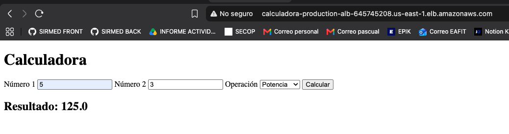
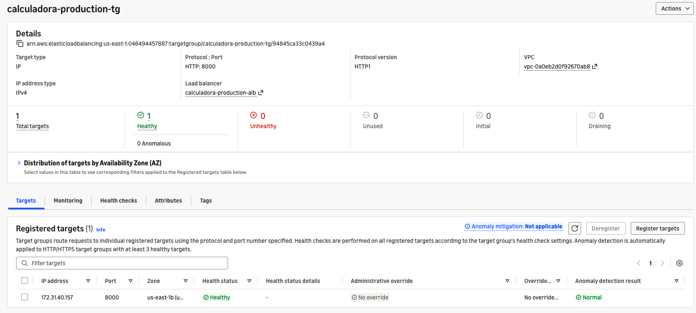

## Integrantes

- Julián Giraldo Chica - Julian-GC
- Joan Sebastian Herrera Montes (**Propietario**) - JoansebHM
- Juan José Henao Aristizábal - Juanjoseh99

## Evidencias
https://github.com/JoansebHM/cicd-pipeline-python-cd/actions/runs/43735029179

https://github.com/JoansebHM/cicd-pipeline-python-cd/pull/1

Staging: http://calculadora-staging-alb-1577913011.us-east-1.elb.amazonaws.com/
Production: http://calculadora-production-alb-645745208.us-east-1.elb.amazonaws.com/

## Justificación SonarCloud
- S6413 (retención de logs corta): Retención de 7 días intencional: es un entorno académico con presupuesto limitado en AWS Academy. Los logs solo se usan para depurar despliegues y no hay requisitos de auditoría.
- S6258 (ALB sin access_logs): Sin access logs por costo y alcance del taller: requeriría un bucket S3 adicional y permisos que el Learner Lab restringe. La app no maneja información sensible y los logs de aplicación ya quedan en CloudWatch.
- S5332 (listener HTTP sin cifrado): HTTP intencional: el ambiente es de laboratorio y no tiene dominio propio ni certificado TLS. La app es una calculadora que no maneja datos personales ni credenciales.

## Preguntas

### I. Explica el flujo completo que implementaste (commit → build-and-test → deploy-staging → test-staging → aprobación → deploy-production → smoke-test-production). Sé específico sobre qué artefacto se mueve entre los jobs, qué hace cada job y qué valida cada tipo de prueba.

Un push o merge a main dispara el pipeline. Los jobs corren en serie, y si uno falla los siguientes no se ejecutan.
* build-and-test (CI): revisa el formato con Black, pasa los linters con Pylint y Flake8 y corre las pruebas unitarias y de componente con cobertura de al menos 80 %. Valida Terraform con fmt -check y validate. Construye la imagen Docker, la levanta en local y corre las pruebas de aceptación con Selenium. Luego hace el análisis en SonarCloud y publica la imagen en Docker Hub.
* deploy-staging: con las credenciales de AWS, conecta con el estado remoto en S3 y corre terraform apply con la imagen. Así crea o actualiza el clúster ECS, el servicio, la task definition, el ALB y los security groups. Entrega la URL del ALB al siguiente job.
* test-staging: consulta /health hasta que responda el SHA nuevo. Después corre las pruebas de aceptación contra la URL pública de Staging. Estas validan los flujos funcionales completos de la calculadora desde el navegador, en un ambiente real de AWS.
* Aprobación manual: el ambiente production exige que un revisor apruebe. Aquí el pipeline pasa de Despliegue Continuo a Entrega Continua.
* deploy-production: hace lo mismo que Staging, pero en el workspace production y con la misma imagen que ya pasó las pruebas.
* smoke-test-production: espera el SHA nuevo y corre las pruebas de humo. Son pruebas rápidas y superficiales que confirman que la app está viva: la página carga, /health responde y la versión desplegada es exactamente el commit esperado.

Cada tipo de prueba valida algo distinto:
* Unitarias: la lógica aislada.
* De componente: la app Flask y sus rutas.
* De aceptación: el comportamiento completo desde el punto de vista del usuario.
* De humo: que el despliegue en Producción quedó sano.

---

### II. ¿Qué ventajas y desventajas encontraste al usar Terraform en vez de crear la infraestructura manualmente desde la consola? ¿Por qué el estado de Terraform se guarda en un bucket S3 y no en tu computador?

Ventajas:

* La infraestructura queda versionada en Git y se puede revisar en un PR.
* Es reproducible: el mismo código crea Staging y Producción, cambiando solo el workspace.
* Se automatiza desde el pipeline y evita errores de clics manuales.
* plan muestra los cambios antes de aplicarlos.
* destroy borra todo fácilmente, lo que ayuda a no gastar el presupuesto.

Desventajas:

* Los errores son más difíciles de corregir que en la consola.
* Las credenciales en laboratorio expiran.
* Si alguien cambia algo a mano en la consola, el estado se desincroniza.

---

### III. ¿Qué ventajas y desventajas tiene introducir un entorno de Staging en el pipeline de despliegue a AWS? ¿Cómo impacta esto la velocidad vs. la seguridad del despliegue?

Ventajas

*	Los errores se detectan en un entorno de ensayo, antes de que lleguen a los usuarios reales.
*	Staging es una copia de Producción en AWS, así que se prueba la app y la infraestructura reales (Load Balancer, contenedor, variables), no solo el código.
*	Si algo falla en Staging, el pipeline se detiene y Producción sigue intacta.

Desventajas

*	El despliegue es más lento, porque hay una etapa y unas pruebas más.
*	Cuesta más, porque hay que pagar y mantener un segundo entorno en AWS.
*	El pipeline y la infraestructura son más complejos de mantener.
*	Staging nunca es 100 % igual a Producción, así que puede dar una falsa sensación de seguridad.
* Velocidad vs. seguridad: Staging sacrifica algo de velocidad a cambio de más seguridad. Cada cambio tarda más en llegar a Producción, pero con mucho menos riesgo de romperla. En un sistema real, el costo de una caída en Producción suele ser mayor que unos minutos extra de espera.

---

### IV. ¿Qué diferencia hay entre las pruebas ejecutadas contra Staging (test-staging) y las ejecutadas contra Producción (smoke-test-production) en tu pipeline? ¿Por qué esta diferencia?

test-staging ejecuta las pruebas de aceptación completas con Selenium. Un navegador real abre la calculadora, escribe números, elige la operación y comprueba que el resultado sea el correcto. Incluye los casos de error, como dividir por cero, y las operaciones nuevas, potencia y módulo. Son pruebas más lentas, de unos 40 segundos en local.

smoke-test-production ejecuta solo pruebas de humo, que son peticiones HTTP sencillas. Comprueban que la página principal cargue, que /health responda "ok" y que la versión desplegada sea la esperada. Tardan unos segundos y no usan la calculadora.

**¿Por qué la diferencia?**

En Staging no hay usuarios reales, así que se puede probar a fondo sin riesgo. Si algo falla, el pipeline se detiene y Producción no se toca.
En Producción sí hay usuarios reales. Por eso solo se hace una verificación rápida y ligera para confirmar que el despliegue quedó vivo y que es la versión correcta, sin simular operaciones ni ensuciar el sistema.

---

### V. Considerando un ciclo completo de DevOps, ¿qué partes importantes (fases, herramientas, prácticas) crees que aún le faltan a este pipeline de CI/CD que has construido? (Menciona 2, explica por qué son importantes y cómo podrían implementarse brevemente).

Creo que le faltan principalmente dos cosas.

La primera es monitoreo y alertas. Hoy el pipeline solo sabe si el despliegue salió bien en el momento, pero después de eso nadie vigila la app. Si Producción se cae a las 3 a. m., nos enteramos cuando alguien se queje. Se podría resolver con alarmas de CloudWatch sobre los targets unhealthy del ALB o los errores 5xx, con una notificación por SNS al correo del equipo.

La segunda es seguridad más completa. SonarCloud nos marcó que el ALB usa solo HTTP, y tuvimos que aceptarlo con justificación porque no hay dominio ni certificado. En un caso real habría que poner HTTPS con un certificado de ACM. También habría que escanear la imagen Docker en busca de vulnerabilidades, con una herramienta como Trivy como un paso más del job build-and-test.

---

### VI. ¿Cómo les pareció implementar las dos funcionalidades nuevas con el pipeline completo? ¿Encontraron útil el CI/CD al hacer cambios y despliegues? ¿Qué no fue tan útil? Cada integrante responde con su experiencia propia, identificándose con su nombre.

**Sebastian Herrera**:  Lo que más me sirvió fue poder ver los cambios en Staging y comprobar que todo funcionaba bien antes de salir a Producción. También me gustó que ese paso a Producción tuviera que autorizarlo una persona y que el flujo no siguiera solo, como si nada. Otra cosa útil fue poder volver a correr solo los jobs que fallaron, sin esperar a que se repitiera todo desde cero.

Lo más engorroso fue SonarCloud. A veces había inconsistencias en las claves (la organización y el project key) y es fácil confundirse, sobre todo cuando el nombre es casi el mismo pero con mayúsculas o puntuación distinta. Eso me hizo perder tiempo en algo que no era del código. En cuanto al tiempo, el pipeline completo se demora aproximadamente 8 minutos, y el paso que más tarda es el despliegue a Producción.

**Juan José**: Hacer las dos funcionalidades nuevas me permitió ver cómo se desencadena de forma automática toda la parte operativa: se ejecutan las pruebas, se despliega en Staging y, después de la aprobación, todo llega a Producción. Lo que no me pareció tan útil fue tener que aprobar manualmente el paso a Producción, porque frena bastante un proceso que, por lo demás, es completamente automático.

**Julian Giraldo**: Implementar las dos funcionalidades con el pipeline completo fue muy útil. Solo escribimos el código y las pruebas, y al hacer push todo lo demás se ejecutó solo: formato, pruebas, análisis de SonarCloud y despliegue en Staging y Producción. El CI/CD nos dio confianza, porque cualquier error se detectaba antes de llegar a Producción.

Lo que no fue tan útil fue la aprobación manual para pasar a Producción, que frena un proceso que por lo demás es automático. Tiene sentido como control en un entorno real, pero se siente innecesaria en cambios pequeños.

---

### VII. Con la aprobación manual, ¿su pipeline implementa Entrega Continua o Despliegue Continuo? ¿Por qué? ¿Qué revisaron en Staging antes de aprobar el paso a Producción? Si una versión nueva no lograra pasar el health check, ¿qué haría ECS y cómo lo detectaría el pipeline?

Con la aprobación manual, el pipeline implementa Entrega Continua y no Despliegue Continuo. Todo el flujo es automático hasta Staging. Al hacer push a main se corren las pruebas, se construye y publica la imagen, se despliega en Staging con Terraform y se ejecutan las pruebas de aceptación. El paso a Producción, en cambio, usa el ambiente production de GitHub, que exige que una persona lo apruebe antes de continuar. Así, cada versión queda siempre lista para salir, pero alguien decide cuándo. En el Despliegue Continuo no existiría esa pausa, y todo cambio que pasara las pruebas llegaría solo a Producción. El README del proyecto lo describe casi igual, cuando dice que en ese paso el pipeline pasa de Despliegue Continuo a Entrega Continua.

Antes de aprobar, el pipeline dejaba listo en Staging todo lo necesario para revisar. Primero esperaba hasta 5 minutos a que la ruta /health respondiera con el SHA del commit nuevo, de modo que las pruebas corrieran contra la versión correcta y no contra la anterior. Después ejecutaba las pruebas de aceptación contra la URL pública del balanceador de carga en AWS, que recorren los flujos completos de la calculadora en un ambiente real. Por último, subía el reporte staging-acceptance-report.html como artefacto. Además, la URL de Staging aparece en el README, así que también se podía abrir la calculadora a mano. Ni el repositorio ni la sesión registran qué revisó cada persona manualmente antes de aprobar, así que eso lo tendrían que confirmar ustedes.

Si una versión nueva no lograra pasar el health check, ECS no la dejaría reemplazar a la actual. El balanceador consulta /health cada 30 segundos y espera una respuesta 200, y tras 3 fallos seguidos marca la tarea como no saludable. ECS arranca la versión nueva sin apagar la vieja, porque el servicio exige 100% de tareas saludables y permite hasta 200% mientras tanto. Como el servicio tiene activado el circuit breaker con rollback, cuando los intentos fallan repetidamente ECS da el despliegue por fallido y vuelve a la versión anterior. Durante todo ese proceso los usuarios siguen siendo atendidos por la versión vieja.

El pipeline lo detecta porque el servicio de Terraform tiene wait_for_steady_state = true, lo que hace que el terraform apply no termine hasta que el despliegue se estabilice. Si ECS hace rollback, el servicio nunca llega al estado esperado con la versión nueva, y el apply falla o se agota. Entonces el job deploy-production se pone en rojo y el smoke-test-production no se ejecuta. Además, el pipeline vuelve a consultar /health esperando el SHA nuevo, y si tras los 5 minutos todavía responde la versión vieja, ese paso también falla.

